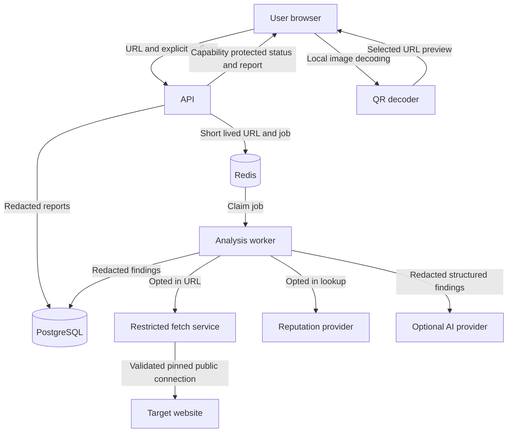

# LinkLens architecture

Decision status: proposed target architecture; incremental implementation authorised. Delivery status: frontend demo implemented; separate Fastify API foundation implemented. Hosted persistence and structural analysis are implemented; queue/worker, optional provider adapters and isolated inspection code are implemented with configuration and release gates described below.

## Structure and ownership

Use a TypeScript monorepo: Next.js web UI, a Fastify API, PostgreSQL, Redis-backed jobs, an analysis worker and a restricted outbound fetch service. One language reduces integration overhead; a separate fetch service costs deployment complexity but makes the untrusted-network boundary explicit. Do not run fetching in a serverless web request. Local development uses Docker Compose; production needs Linux containers and enforceable egress rules before active inspection is enabled.

The browser alone handles QR pixels. The API manages capabilities, limits and report reads. The worker owns rules and verdicts. Only the fetch service contacts user-selected websites. Provider clients use fixed configured service origins and cannot be repurposed as fetch proxies.

## Data model

- `scan`: UUID, capability digest, created/expires timestamps, state, input kind, consent booleans, redacted URL display, domain components, verdict, rule/catalogue/suffix versions, coverage JSON, failure code. Index expiration and state; unique UUID.
- `finding`: scan ID, rule ID, severity, bounded structured evidence, explanation key. Unique `(scan_id, rule_id, evidence_key)`.
- `check_result`: scan ID, check name, status (`passed|finding|skipped|unavailable|blocked`), reason, checked timestamp, duration. Unique `(scan_id, check_name)`; status `passed` means that check completed without its indicator, not that a site is safe.
- `redirect_hop`: scan ID, ordinal, redacted URL/domain, HTTP status, outcome. Unique `(scan_id, ordinal)`.
- `explanation`: scan ID, source (`template|ai`), validated text/citation JSON, provider/model identifier and prompt version. No raw prompts or provider responses in logs.

Redis stores transient exact URL payloads with 5-minute expiration, job IDs and short-lived rate-limit counters. Queue jobs contain scan IDs only. No exact URL in queue result/history. Worker deletes payload in a finally block. No target URL cache across users. Report deletion cascades child rows. Database backups are disabled for the initial ephemeral-report deployment; managed provider retention must be documented before launch.

## Runtime and consistency

API validates input, creates a queued report, stores a transient payload, and enqueues by scan ID. Enqueue failure deletes the payload and marks the scan failed; stale queued scans are failed by a sweeper. Worker claims with a bounded lease, runs analysis, persists one complete result transaction, then deletes transient data. Duplicate delivery cannot overwrite a completed result. No automatic retries of target visits or external lookups; users explicitly submit a fresh scan. A stale running job is failed rather than replayed. Target/provider failure produces a partial completed report whenever structural evidence exists. A malformed input creates no report.

## Shared rules

- INV-1: Target network requests exist only inside the restricted fetch service. Enforce with network policies and code boundaries; prove with integration tests and outbound firewall tests.
- INV-2: Reject any non-global address, including mixed public/private DNS answers, IPv4-mapped IPv6, metadata ranges, loopback, link-local, multicast, reserved and transition/translation ranges unless safely classified. Resolve all A/AAAA answers, validate them, pin one validated address to the actual socket, preserve hostname for TLS/SNI/Host, and verify peer address. Never validate then re-resolve in the HTTP client. Apply the same process at every hop. Do not inherit proxy environment variables. Independently deny internal networks at egress.
- INV-3: Verdict is a pure versioned function of findings and coverage. AI has no write access to verdicts or rules; prove with unit tests and hostile AI-output fixtures.
- INV-4: Exact user URL exists only in memory/transient Redis; reporting and observability use allowlisted redacted fields. Prove via sentinel-token storage/log inspection.
- INV-5: Read/delete require a 256-bit random report capability. Store only its digest. Use URL fragments for browser sharing, then an authorization header; never query parameters. Constant-time digest comparison. Missing/wrong capabilities return indistinguishable 404 responses.
- INV-6: No target HTML or remote resource is rendered or executed. Escape all evidence; forbid target hyperlink previews and remote favicons. Enforce CSP and test malicious strings.

## Operations and limits

Fetch supports ports 80/443 only, up to 5 redirects (6 requests), a 2-second DNS budget/hop, 3-second connect budget and 15-second overall target-inspection budget. Use GET headers with streaming aborted immediately after headers; never buffer page bodies. Bound headers to 32 KB. It can still trigger server-side activity, hence explicit consent. No fallback to browser automation. Report all unsupported redirects, TLS errors, loops and budget exhaustion.

Reputation has a 3-second total budget and at most 6 lookups for the observed chain, with bounded concurrency; AI has an 8-second budget and one call/report. Core processing has a 30-second deadline, optional AI another 8 seconds; API polling expires at 45 seconds with recovery guidance. These are designed bounds, not measured latency. Expose aggregate durations, check failures and counts without URL data; redact access logs, telemetry, error tracking and request bodies. Global concurrency, provider-call ceilings and an operator kill switch bound spend. No budget alert is treated as a hard spending cap.

Delete expired reports hourly, making them unreadable immediately at expiry even before physical deletion. Purge transient data on startup recovery. Deploy schema migrations before new writers; roll back application images only across compatible schemas. Feature flags independently disable fetching, reputation and AI. Never enable active inspection when network isolation is unavailable.

## Risks and proof

Domain similarity is heuristic and can misidentify legitimate sites. Reputation lists miss new threats. HTTP-only checks miss JavaScript redirects. URLs may contain sensitive paths even after query removal; persist paths as `/[redacted]` and redact path segments from all provider-bound AI input. A successful HTTP response or valid certificate proves neither trust nor payment legitimacy. Required proofs are in docs/linklens-mvp/spec.md. Production egress validation and live provider credentials remain implementation/deployment prerequisites; no implementation checks have run.

## Current implementation: API foundation

`server/app.ts` owns the separate Fastify API; `server/index.ts` starts it on loopback port 4000 by default and handles shutdown. The existing Next.js frontend remains at the repository root. This additive layout avoids relocating the working frontend; a workspace split can follow when worker packages exist. The diagram above describes the intended full system, not the currently running features.

`GET /api/health` exposes process liveness and explicitly disabled scan/provider capabilities. It does not establish database, queue or analysis readiness. Scan create/read/delete endpoints return 503 NOT_READY until the next stages implement their contracts. No scan data is stored or processed. `/status` in the frontend makes a user-triggered, abortable health request; scans remain in mock mode.

The API has an 8 KB body limit, sanitised errors, no request logging, explicit CORS origins and no-store/noindex response headers. CORS is browser access policy, not authorization. Capabilities, server validation, provider consent enforcement and deployment isolation still need their own implementation and proof. No Google credentials or user login are required for the foundation.

## Implemented storage stage

Hosted Neon PostgreSQL is configured through the server-only DATABASE_URL. Migration files live in server/db/migrations and are applied explicitly with an advisory migration lock. The scan table stores capability SHA-256 digests, authoritative database timestamps, and a redacted report JSON snapshot; scan_cancellation stores short-lived deletion tombstones. At this incremental stage findings/checks/redirects remain within the snapshot, rather than the intended normalized worker tables above. Normalization and queued/running state persistence belong to the analysis/worker stages.

GET and DELETE report routes use Bearer capabilities, constant-time digest comparisons and server-side expiration. Deletion records cancellation and removes a report in one transaction. Hourly cleanup runs only while the API process is running; immediate expiry is enforced on reads. No public create route is enabled. Internal storage accepts completed, already redacted report evidence; comprehensive evidence redaction is a prerequisite for the future worker. Neon provider restore/history retention must be reviewed before real sensitive scans launch; 24-hour application expiry does not prove provider backup erasure. Local PostgreSQL is stopped. Five integration tests passed against Neon, with temporary records removed.

## Implemented structural analysis stage

server/analysis/analyse.ts owns server validation and deterministic versioned rules; brands.json defines the initial ten-brand catalogue and supported ASCII substitutions. POST evaluates only URL text, redacts before persistence and returns a completed receipt (201). The existing typed frontend HTTP adapter now accepts completed receipts. This intentionally differs from the target queued 202 contract until the Redis worker stage. Every structural-only report has partial coverage; unavailable providers never appear passed. No target networking, external reputation request or AI request exists. The frontend disables unavailable consent options in HTTP mode.

Database schema is unchanged; reports remain JSON snapshots in scan. Exact input URL is scoped to the request and analyser memory only, never inserted in scan or logged. Rate limits/global concurrency, queue processing, provider integration, production egress isolation and a reviewed external evaluation corpus are still missing; the current loopback API is not ready for public deployment.

## Queue and optional-service implementation

Migration 002 adds authoritative queued/running/completed/failed state and update timestamps. The local Fastify process starts a logical BullMQ worker when Redis is configured; the worker can be split into its own deployment later. BullMQ enforces global concurrency four; atomic Redis admission bounds submissions and active jobs. Queue messages contain IDs only. Exact URLs live in 300-second Redis payload keys and are removed with GETDEL on claim. Redis TLS is required outside loopback. Provider restore/history retention remains an external privacy prerequisite.

POST now returns 202/queued in queue mode; direct 201/completed mode is a non-production development fallback only. Duplicate deliveries cannot claim a running/completed scan, external effects are never automatically retried, a 30-second worker deadline applies, and a sweeper fails stale work after 45 seconds. State updates never upsert reports. Deletion is atomic with a cancellation tombstone and Redis payload/job cancellation is best effort. Admission hashes client identifiers, and only explicit trusted proxy CIDRs may affect client IP. Provider budgets are shared Redis counters.

Google Safe Browsing calls use the fixed official lookup origin, header authentication, a three-second shared budget and at most six observed URL lookups; they require consent and an explicit enable flag. The distinct inspection service implements per-hop DNS classification, pinned sockets, peer verification and headers-only bounded redirects. Both services feed deterministic verdicts and template explanations. Inspection requires an additional network-isolation confirmation flag; the flag itself is NOT proof. No deployment or independent firewall verification is complete. AI remains off.

The offline synthetic-policy manifest, deterministic unit/provider/network tests, ephemeral Redis/Neon integration tests and queued browser journey provide implementation evidence; they do not establish real-world threat-detection quality or live provider credentials. Hosting is explicitly deferred by the user.

## Portfolio reputation implementation

The non-commercial portfolio uses Google Safe Browsing v4 threatMatches:find via POST to a fixed Google origin. The private GOOGLE_SAFE_BROWSING_API_KEY remains server-side. Lookup requires explicit user consent; responses are bounded and validated, URLs are fragment-free, and no-match never guarantees safety. Reports requesting reputation lookup expire after thirty minutes from database creation; other reports expire within twenty-four hours. Google match warnings include advisory attribution and limitations. Hosted Redis/Neon queue processing and a real Google lookup have been verified; redirect inspection remains disabled until independent egress isolation is proven. Hosting is deferred.
